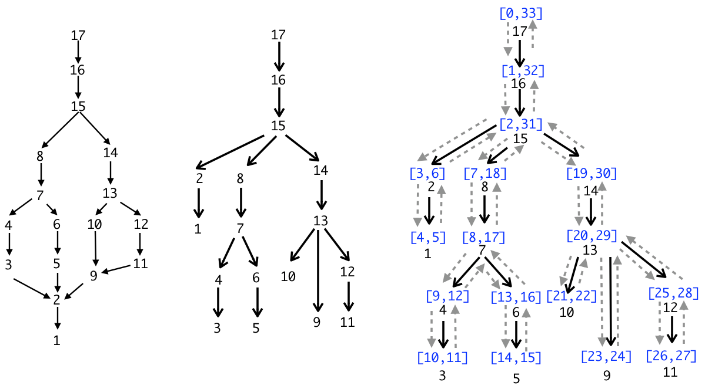

<figure>
 
 <figcaption>Figure and below caption from <a href="/assets/img/dominators-verified.pdf">Validating Dominator Trees for a Fast, Verified Dominance Test</a> (PDF) by Blazy,
 Demange, and Pichardie.  
 Left: example CFG, with entry point 17, and nodes ordered in
reverse post-order (on the left). Center: its dominator tree (where, if <i>i</i> has <i>j</i> as a child, then <i>i</i> is the immediate dominator of <i>j</i>). Right: dominator tree (solid arrows), annotated with a DFS traversal (dotted arrows), and its
corresponding DFS intervals.</figcaption>
</figure>
